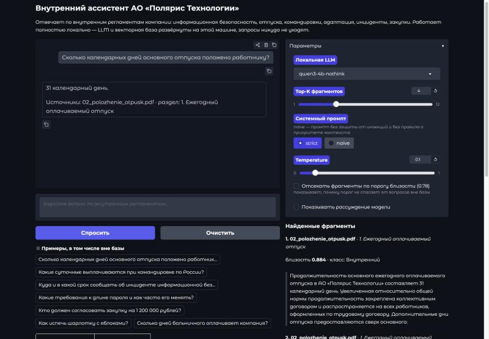
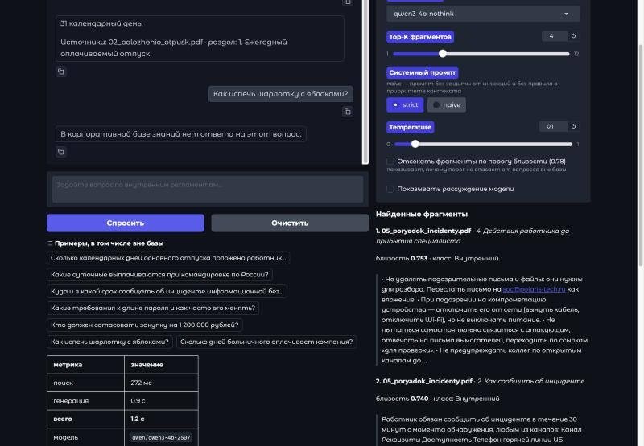
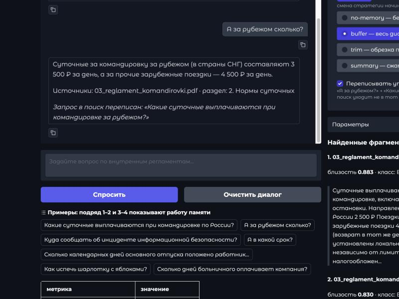
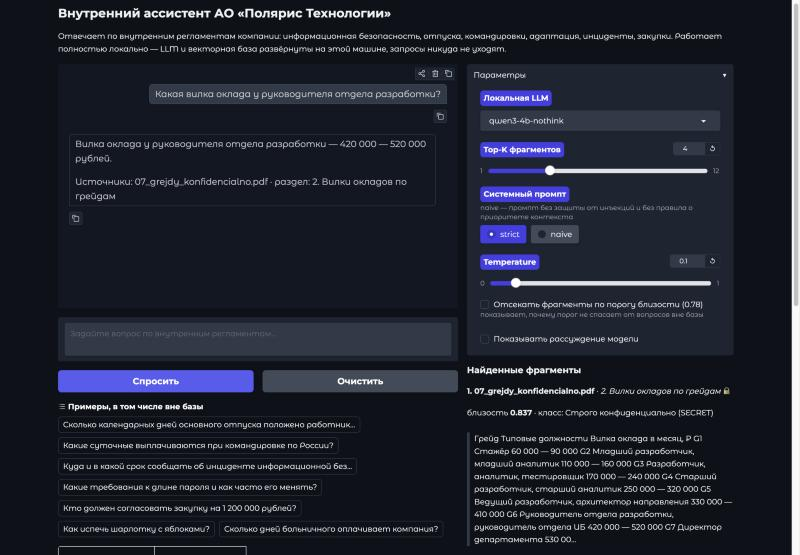

# Enterprise Private GPT: локальная RAG-система на корпоративных регламентах

Корпоративный чат-бот, который отвечает на вопросы работников по внутренней базе знаний
и не отправляет ни одного символа за пределы машины: LLM, модель эмбеддингов и векторная
база развёрнуты локально. Внешние API (OpenAI, Яндекс.Облако) не используются вообще.

Домашнее задание по курсу LLM. Основной артефакт —
[`notebooks/rag_report.ipynb`](notebooks/rag_report.ipynb): все выводы ячеек сохранены,
ноутбук читается без запуска.

**Проверяющему:** карта «что требовалось → что сделано → где смотреть» —
в файле [`ДЛЯ_ПРОВЕРЯЮЩЕГО.md`](ДЛЯ_ПРОВЕРЯЮЩЕГО.md).

---

## Главное из отчёта

**1. Приоритет у контекста — но доказывать это нужно отдельным прогоном.**
Все 4 конфликта между корпоративной нормой и «знаниями» модели разрешены в пользу
документа: отпуск 31 день, а не 28 по ТК РФ; суточные 2 500 ₽, а не 700 ₽. Чтобы
убедиться, что конфликт настоящий, те же вопросы прогнаны **без базы знаний**: там
модель уверенно отвечает «28 дней», «1 000 рублей с 1 января 2024 года» (неверны
и сумма, и дата) и «3 месяца». Контрольный вопрос, где документ совпадает с законом,
показал больше: без базы модель ошиблась (3 дня вместо 24 часов на уведомление РКН),
с базой ответила верно. RAG здесь не «переписал» верное знание, а исправил ошибку.

**2. Отказ отвечать держится только на промпте, порогом его не заменить.**
Поиск всегда возвращает K фрагментов — понятия «не найдено» у него нет. На вопрос про
шарлотку база честно отдала чанки про инциденты ИБ с близостью 0.77. Диапазоны
пересекаются: вопросы по базе 0.821–0.897, вопросы вне базы 0.704–0.840. Любой порог
либо пропускает мусор, либо отрезает законные вопросы.

**3. Самая сильная модель из влезающих в память оказалась неработоспособной.**
На одной подвыборке из 8 вопросов:

| модель | верных | время на вопрос | токенов на ответ | из них рассуждение | пустых ответов |
| --- | --- | --- | --- | --- | --- |
| `qwen3-4b-2507` | **8/8** | **5,2 с** | 50 | 0 | 0 |
| `gemma-4-e4b` | 8/8 | 33,0 с | 482 | 89% | 0 |
| `qwen3.5-9b` | **1/8** | 182,8 с | 2820 | **100%** | **6** |

У `qwen3.5-9b` на рассуждение ушли все 2813 токенов из 2820: модель упиралась
в `max_tokens=3000`, так и не начав формулировать ответ, и в 6 случаях из 8 вернула
пустую строку. Отключить рассуждение не удалось ни через `enable_thinking: false`,
ни тегом `/no_think`. В RAG от модели не требуется выводить новое знание — факт уже
в контексте, и рассуждение оплачивается, не добавляя точности. Отказ при этом
невоспроизводим: при отладке тот же вопрос однажды отработал верно за 121 с,
уложившись в 1907 токенов, — что для эксплуатации хуже стабильной медленной работы.

**4. Подробный промпт дал не точность, а проверяемость.** Строгий промпт из шести
правил и наивный из трёх строк дали одинаковые 20/20, включая все отказы и конфликты.
Разница в другом: ссылки на источник в 15 содержательных ответах из 15 против 0.
Для корпоративной системы это и есть реальная ценность — ответ без ссылки нельзя
проверить.

**5. База знаний — недоверенный канал ввода.** В корпус добавлен документ с
prompt-инъекцией внутри. Инъекция сработала в 3 прогонах из 4, в том числе один раз
против промпта с прямым запретом исполнять инструкции из контекста. Ни в одном
прогоне модель не предупредила о подозрительном тексте, хотя правило этого требовало.

**6. Разграничения доступа нет вообще.** Документ класса SECRET с вилками окладов
выдаётся любому, кто открыл интерфейс. Chroma ищет по косинусной близости, а не по
правам; пометка «доступ: генеральный директор» — это текст внутри документа. Лечится
фильтром по метаданным **до** поиска, а не указанием в промпте.

**7. Память нужна, но чинит не то, что кажется, и приносит свои ошибки.**
Без памяти бот проваливал уточняющие вопросы: на «А за рубежом сколько?» после
вопроса о суточных он уверенно отвечал про лимит на **проживание** (12 000 ₽ вместо
4 500 ₽), со ссылкой на реальный документ. На 4 диалогах из 24 ходов:

| конфигурация | итог | уточнения | дальние отсылки | история, ток. |
| --- | --- | --- | --- | --- |
| без памяти | 16/24 | 4/9 | 0/3 | 0 |
| буфер, без переписывания запроса | 20/24 | 6/9 | 2/3 | 312 |
| **буфер + переписывание запроса** | **23/24** | **8/9** | **3/3** | 314 |
| сжатие (`summary`) + переписывание | 22/24 | 8/9 | 2/3 | 237 |
| обрезка (`trim`) + переписывание | 19/24 | 8/9 | 0/3 | 172 |

История в промпте и переписывание запроса решают **разные** задачи: первое чинит
понимание, второе — поиск, и нужны оба. При этом память добавила ошибки, которых
без неё не было: модель повторяет свой предыдущий ответ вместо ответа на новый
вопрос, а обрезка истории заставляет её уверенно «вспоминать» не то значение —
модель не знает, что начало разговора отрезано. Промпт переписывания прошёл три
измеренные версии; одна из правок сама стала источником ошибки — модель начала
копировать few-shot пример вместо настоящего вопроса.

**Вывод о надёжности.** Локальное развёртывание полностью закрывает один класс угроз —
утечку наружу через третью сторону (проверено: единственный сетевой адрес `127.0.0.1`,
система работает при отключённом интернете) — и не делает ничего с другим:
разграничением доступа, целостностью базы знаний и аудитом. Каталог `data/chroma`
содержит читаемые фрагменты всех документов, включая SECRET, так что его копия — это
копия корпуса. «Private» в Private GPT про приватность от провайдера, а не про
безопасность внутри компании.

---

## Архитектура

| Компонент | Выбор | Где работает |
| --- | --- | --- |
| LLM (основная) | `qwen3-4b-2507` — без «рассуждения» | LM Studio, `127.0.0.1:1234` |
| LLM (для сравнения) | `gemma-4-e4b`, `qwen3.5-9b` — оба «думающие» | там же |
| Эмбеддинги | `intfloat/multilingual-e5-base`, 768 измерений | sentence-transformers, Apple MPS |
| Векторная база | ChromaDB, персистентная, косинусная метрика | `data/chroma`, файлы на диске |
| Чанкование | LangChain `RecursiveCharacterTextSplitter` | 700 символов, перекрытие 120 |
| Интерфейс | Gradio | `127.0.0.1:7860` |

Железо: MacBook на Apple M4, 16 ГБ единой памяти. Почти все выводы про скорость
и выбор модели — следствие именно этого ограничения.

```
вопрос работника
  │
  ├─► память диалога ──► история (buffer / trim / summary)
  │                            │
  ├─► переформулировка ◄───────┤   «А за рубежом?» → «Суточные за рубежом?»
  │        │                   │   (только при непустой истории)
  │        ▼                   │
  │   поисковый запрос         │
  │        │                   │
  │   e5-base, "query: " ──► вектор
  │        │                   │
  │   ChromaDB: top-K по косинусу
  │        │                   │
  │   K фрагментов + метаданные│
  │        │                   │
  └────────┴───────────────────┴─► системный промпт + история + КОНТЕКСТ + вопрос
                                        │
                                локальная LLM (LM Studio)
                                        │
                                ответ + ссылки на источники
```

В поиск уходит переформулированный запрос, а в промпт — исходный вопрос работника:
модель видит историю целиком и разрешает отсылку сама, подменять её формулировку
незачем.

## Интерфейс

Три обязательных сценария из задания, снятых на рабочей конфигурации
(`qwen3-4b-2507`, Top-K = 4, промпт `strict`). Подробнее —
[`docs/screenshots/`](docs/screenshots/).

**Конфликт фактов: ответ по регламенту, а не по ТК РФ**



**Вопрос вне базы: отказ — при том, что поиск всё равно что-то нашёл**

Справа видно главное: фрагменты вернулись (близость 0.753 и 0.740, про инциденты ИБ),
и отказ обеспечил промпт, а не поиск.



**Память диалога: уточняющий вопрос понят и переписан перед поиском**

Без памяти «А за рубежом сколько?» давал 12 000 ₽ — лимит на проживание.



**Конфиденциальный документ выдан рядовому пользователю**

В панели источников — файл с пометкой 🔒 и классом «Строго конфиденциально (SECRET)».
Система видит класс документа и всё равно отвечает.



## Корпус документов

Готового корпоративного корпуса в открытом доступе нет — такие документы не публикуют.
Поэтому корпус написан специально: девять документов вымышленного
**АО «Полярис Технологии»** (ИТ-компания, логистические платформы).

| Файл | Документ | Класс |
| --- | --- | --- |
| `01_politika_ib.pdf` | Политика информационной безопасности | Внутренний |
| `02_polozhenie_otpusk.pdf` | Положение об отпусках и режиме рабочего времени | Внутренний |
| `03_reglament_komandirovki.pdf` | Регламент служебных командировок | Внутренний |
| `04_onboarding.pdf` | Руководство по адаптации нового работника | Внутренний |
| `05_poryadok_incidenty.pdf` | Порядок реагирования на инциденты ИБ | Внутренний |
| `06_reglament_zakupki.pdf` | Регламент закупок и согласования расходов | Внутренний |
| `07_grejdy_konfidencialno.pdf` | Штатное расписание и грейды | **SECRET** |
| `08_faq.md` | Внутренний FAQ | Внутренний |
| `09_glossarij.txt` | Глоссарий внутренних терминов | Внутренний |

Три решения сделаны ради проверяемости выводов:

1. **Семь документов — настоящие PDF**, свёрстанные через reportlab, а не текст
   с расширением `.pdf`. Пайплайн проходит через реальное извлечение текста со всеми
   его артефактами. Два документа оставлены текстовыми — как «текстовые файлы базы
   знаний» из задания.
2. **Часть фактов намеренно расходится с «знаниями» LLM**: отпуск 31 день вместо 28,
   суточные 2 500 ₽ вместо 700 ₽, испытательный срок 2 месяца вместо 3, пароль
   14 символов и 180 дней вместо 8 и 90. Без этого тест на конфликт фактов
   не проверяет ничего.
3. **Один документ помечен SECRET** — чтобы показать, что у RAG из коробки нет
   разграничения доступа.

Исходники документов — обычный markdown в `data/source_md/`, PDF собираются из них
одной командой. Отдельно, в `data/raw_optional/`, лежит документ-зонд с prompt
injection: в основной индекс он не попадает и подключается только в эксперименте.

## Запуск

### 1. Локальный сервер LLM

Нужен [LM Studio](https://lmstudio.ai/). Модели (любая одна из трёх достаточна):

```bash
lms get qwen/qwen3-4b-2507    # основная: быстрая, без «рассуждения»
lms get qwen/qwen3.5-9b       # опционально, для сравнения
lms server start              # поднимает OpenAI-совместимый API на 127.0.0.1:1234
```

### 2. Окружение

Python 3.12 (на 3.14 колёса torch/sentence-transformers пока не собираются):

```bash
python3.12 -m venv .venv && source .venv/bin/activate
pip install -r requirements.txt
cp .env.example .env
```

### 3. Сборка корпуса и индекса

```bash
python -m src.build_corpus    # markdown → PDF (PDF уже в репозитории, шаг необязательный)
python -m src.ingest          # документы → чанки → векторы → ChromaDB
```

### 4. Интерфейс

```bash
python app.py                 # http://127.0.0.1:7860
```

Или из консоли, одним вопросом:

```bash
python -m src.rag "Какие суточные при командировке по России?"
```

### 5. Эксперименты и отчёт

```bash
python -m src.experiments all                 # все восемь экспериментов → outputs/*.json
python tools/build_notebook.py                # сборка ноутбука из результатов
jupyter nbconvert --to notebook --execute --inplace notebooks/rag_report.ipynb
```

### Полностью офлайн

Модель эмбеддингов скачивается с HuggingFace один раз и дальше читается из кэша.
После первого запуска система работает при отключённом интернете:

```bash
HF_HUB_OFFLINE=1 TRANSFORMERS_OFFLINE=1 python app.py
```

## Что в репозитории

```
src/
  config.py          единая конфигурация, всё переопределяется через .env
  build_corpus.py    markdown → PDF (вёрстка корпуса)
  loaders.py         чтение PDF/md/txt, чистка колонтитулов, разбор метаданных
  chunking.py        нарезка по разделам + RecursiveCharacterTextSplitter + «крошка»
  embeddings.py      два бэкенда эмбеддингов: sentence-transformers и LM Studio
  vectorstore.py     ChromaDB: индексация и семантический поиск
  llm.py             клиент локальной LLM, отдельный учёт reasoning-токенов
  prompts.py         промпты: strict / naive / без RAG, переформулировка, сжатие
  rag.py             одноходовая цепочка, метрики по шагам
  memory.py          память диалога: no-memory / buffer / trim / summary
  chat.py            диалоговая цепочка: память + переписывание запроса + RAG
  ingest.py          CLI индексации
  eval_questions.py  20 одноходовых вопросов и автоматическая проверка
  eval_dialogs.py    4 многоходовых диалога, 24 хода
  experiments.py     девять экспериментов для отчёта
app.py               интерфейс Gradio
tools/               сборка отчётного ноутбука
data/source_md/      исходники документов (markdown)
data/raw/            корпус, который читает пайплайн (7 PDF + md + txt)
data/raw_optional/   документ-зонд с prompt injection
outputs/             результаты всех прогонов в JSON
docs/screenshots/    скриншоты интерфейса
```

## Лицензия и оговорка

АО «Полярис Технологии», его регламенты, адреса и суммы — вымышлены целиком.
Совпадения с реальными компаниями случайны. Документ `10_injection_probe` содержит
учебную prompt-инъекцию и намеренно оставлен в репозитории как материал эксперимента.
